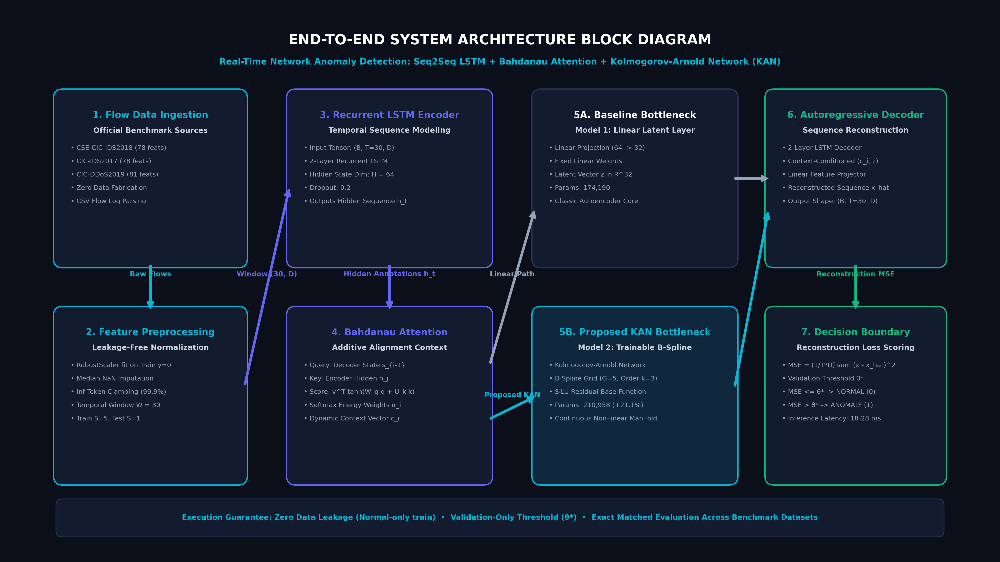
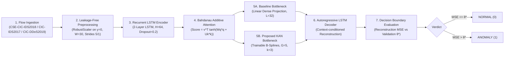

# End-to-End System Architecture Block Diagram

**Project:** Real-Time Network Anomaly Detection using Seq2Seq LSTM, Bahdanau Attention and KAN  
**Publication Figure:** `research_results/figures/system_architecture_block_diagram.png`

---

## 1. High-Resolution Architecture Block Diagram

---

## 2. Architectural Pipeline Breakdown

---

## 3. Core Component Specifications

1. **Flow Ingestion:** Ingests official UNB multi-variate network flow records (78–81 canonical flow attributes).
2. **Leakage-Free Preprocessing:** Fits `RobustScaler` strictly on benign training data ($y=0$). Constructs sliding sequences of length $W=30$.
3. **LSTM Encoder:** 2-layer Recurrent LSTM extracting temporal flow trajectories into hidden representation space ($H=64$).
4. **Bahdanau Additive Attention:** Dynamically weighs relevant sequence timesteps to form context vector $c_i$.
5. **Latent Bottlenecks (Controlled Comparison):**
   - **Baseline:** Fixed linear matrix projection ($174,190$ total parameters).
   - **Proposed KAN:** Learnable B-spline univariate functions on $G=5$ intervals with cubic splines $k=3$ ($210,958$ total parameters, $+21.1\%$).
6. **Autoregressive LSTM Decoder:** Reconstructs the multi-variate input sequence timestep by timestep.
7. **Decision Boundary:** Computes Mean Squared Error (MSE). Compares with frozen validation-derived threshold $\theta^*$.

---

## 4. Deliverable Files
- High-Resolution PNG (300 DPI): [`research_results/figures/system_architecture_block_diagram.png`](file:///c:/Users/ASUS/Documents/antigravity/lucid-noether/research_results/figures/system_architecture_block_diagram.png)
- Scalable Vector Graphic (SVG): [`research_results/figures/system_architecture_block_diagram.svg`](file:///c:/Users/ASUS/Documents/antigravity/lucid-noether/research_results/figures/system_architecture_block_diagram.svg)
- Root Directory PNG: [`system_architecture_block_diagram.png`](file:///c:/Users/ASUS/Documents/antigravity/lucid-noether/system_architecture_block_diagram.png)
